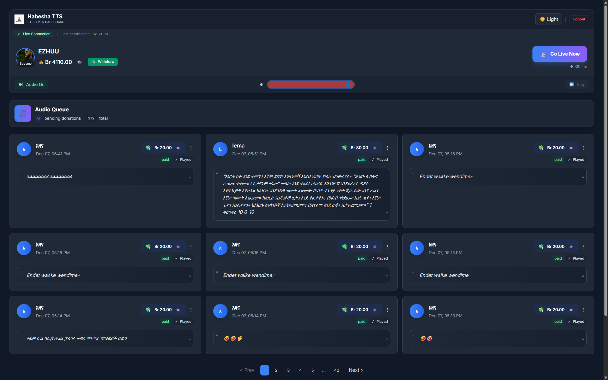
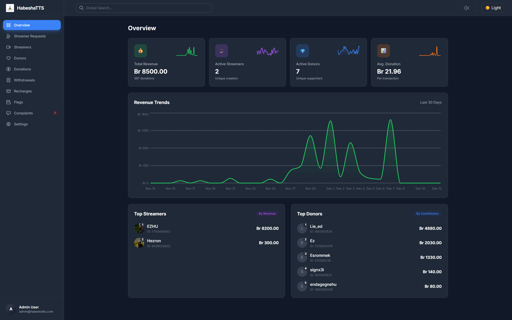
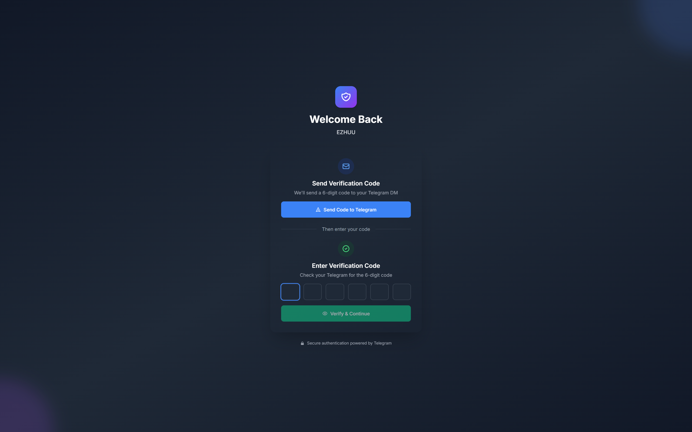
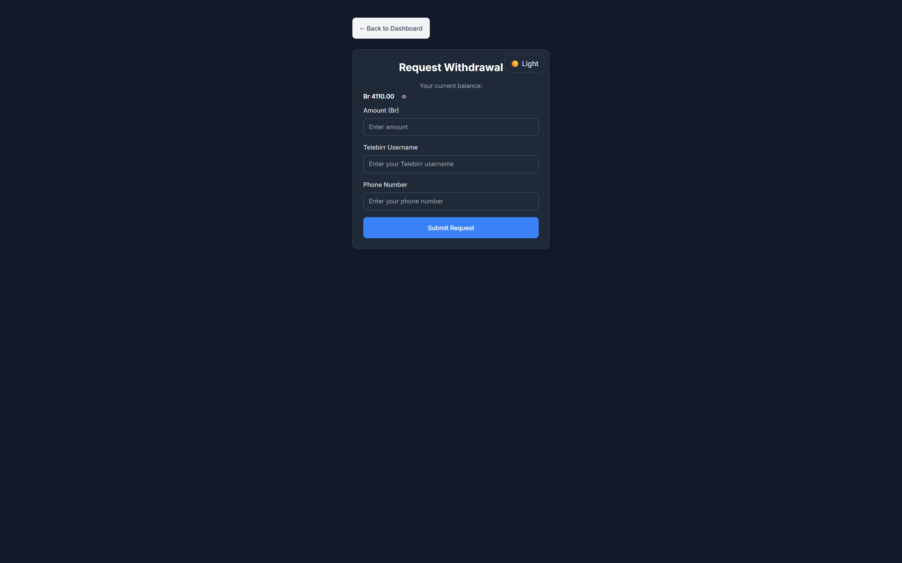

<div align="center">

# HabeshaTTS

**AI-powered Amharic text-to-speech donations for streamers.**

Donors top up a wallet over Telegram, write a message, and pick a voice. The platform
synthesises that message into Amharic speech and pushes it to the streamer's dashboard,
where it plays out loud over their stream.

[habeshatts.com](https://habeshatts.com/)

Node · Express · Socket.IO · BullMQ · Redis · PostgreSQL · Google Cloud TTS · Gemini TTS · Docker

</div>

---

## Screenshots

| Streamer dashboard | Admin console |
|---|---|
|  |  |

| OTP login | Withdrawal request |
|---|---|
|  |  |

---

## How it works

**The donor side is Telegram-only.** There is no donor web UI — donors never leave the bot.

1. **Register** — `/start`, then register as a donor and set a display name.
2. **Top up** — `/recharge` picks an amount in ETB. The bot returns a Telebirr account to
   transfer to, then asks for the payer name and a payment screenshot. This creates a
   *pending* recharge.
3. **Admin approves** — an operator verifies the screenshot against the bank statement and
   approves the recharge, which credits the donor's wallet balance.
4. **Pick a streamer** — `/donate` lists approved streamers with live-status indicators.
5. **Write the message** — length-checked against a configurable maximum, and screened
   against an admin-editable profanity filter. Price is charged per character block
   (20 ETB base + 10 ETB per 30 characters by default).
6. **Pick a voice** — 12 options: 10 Gemini TTS voices and 2 Google Wavenet voices.
7. **Pay from wallet** — balance is checked, SSML is built, and a synthesis job is enqueued.
8. **Worker synthesises** — TTS runs first, then a single transaction marks the donation
   paid, decrements the donor, and credits the streamer. The write is guarded on row count,
   so a retried job cannot double-pay.
9. **Fan-out** — the audio URL is pushed over Socket.IO to the streamer's room and the admin
   room, and the donor gets a Telegram confirmation with their new balance.

**The streamer side is a web dashboard.** Streamers sign in with a 6-digit OTP delivered to
their own Telegram, and get a live dashboard with a Web Audio playback queue, volume control,
a live-status toggle, notification-sound selection, donation history, and withdrawal
requests.

**The admin side is a 10-tab console** — overview metrics and a 30-day revenue chart,
streamer approvals, donor and streamer management, donations, withdrawals, recharge
approvals, moderation flags, complaints, and runtime settings. Settings changes (pricing,
word filter) hot-reload into the running bot without a redeploy.

---

## Speech synthesis

Two engines behind one interface in `bot/utils/tts.js`:

| Engine | Client call | Notes |
|---|---|---|
| **Google Cloud TTS** | `synthesizeSpeech` with SSML | Voices like `am-ET-Wavenet-A`. Supports `<break>` pauses. Default engine. |
| **Gemini TTS** | `synthesizeSpeech` with `modelName: gemini-2.5-pro-tts` | Style-directed via a natural-language prompt instead of SSML. Gated behind `ENABLE_GEMINI_TTS=true`. SSML is stripped before the call because the model handles it poorly. |

`am-ET` is hardcoded as the language code on both paths. Raw Ethiopic goes straight in —
there is no transliteration or translation step.

Input is sanitised before synthesis: zero-width characters (`U+200B`–`U+200D`, `U+FEFF`) and
Unicode control characters are stripped, while SSML tags are deliberately preserved. Invisible
characters are a well-known trigger for provider moderation errors.

**Moderation failures are treated as terminal, not retryable.** When the provider returns a
moderation error, the job is marked `failed_moderation` with no retry, and the donor is
told in DM that they have not been charged. Gemini quota exhaustion (`code 8`) is handled
separately as `failed_quota`.

> **Note on the "generative AI" packages.** `@google/genai`, `@google/generative-ai`, and
> `@google-ai/generativelanguage` are declared in `package.json` but are not imported
> anywhere in the codebase. Gemini's only role here is as a *TTS voice model* reached through
> the Text-to-Speech API — it does not generate donation messages or any other content.
> Those three dependencies can be removed.

---

## Architecture

Everything runs in **one Node process** — the HTTP API, the BullMQ workers, and the Telegram
bot all start from `node backend/index.js`.

```
backend/          Express API, Socket.IO server, BullMQ workers, admin routes
bot/              Telegram bot (donor surface) + TTS layer
frontend/         React 18 + Vite — streamer dashboard, admin console, landing page
scripts/          Benchmarks, DB init and one-off migrations
docs/             Ministry submission package and partnership proposal
```

### Redis is required, and does four jobs

| Role | Detail |
|---|---|
| BullMQ transport | Backs both synthesis queues. TLS is auto-detected from a `rediss://` scheme or a `.upstash.io` host. |
| Bot singleton lock | `SET bot_instance_lock <id> NX EX 60`, refreshed every 30s by an owner-checked Lua script. If the lock is lost, Telegram polling stops. This is why production deploys as a single instance. |
| Bot conversation state | Dual-written to Redis and memory with TTLs, falling back to memory-only if the connection drops. |
| Health gate | `/health` returns **503** if a Redis ping fails. |

### The synthesis pipeline

`backend/queue-optimized.js` runs two queues — `tts-generation` and `gemini-tts-generation` —
with separate workers, concurrency, and rate limiters, all env-tunable.

- Synthesis runs **before** a database connection is acquired, so a slow TTS call never
  holds a connection from the pool.
- Jobs are enqueued with `jobId: donation_<id>`, which makes the enqueue itself idempotent.
- `stalledInterval` is set to 60s to conserve Redis quota.

### Real-time delivery

Socket.IO carries **metadata only — never audio bytes**. The `new_donation` payload includes
an `audio_url` pointing at Google Cloud Storage; the browser fetches it and plays it through
the Web Audio API.

Audio is uploaded to a GCS bucket with `cacheControl: public, max-age=86400`, so it is
durable and CDN-cacheable. Ping intervals are deliberately tight (10s interval / 5s timeout)
to keep connections alive through browser tab inactivity.

Rooms are keyed by the streamer's UUID, plus an `admin` room. Every admin-relevant state
change also raises a formatted alert to the Telegram admin channel.

---

## Stack

| Layer | Technology |
|---|---|
| Runtime | Node.js 20, ES modules |
| HTTP | Express 4, Socket.IO 4 |
| Jobs | BullMQ on Redis |
| Database | PostgreSQL (`pg` connection pool) |
| Speech | Google Cloud Text-to-Speech, Gemini 2.5 Pro TTS |
| Storage | Google Cloud Storage |
| Bot | `node-telegram-bot-api` |
| Frontend | React 18, Vite 4, Tailwind CSS 3, React Router 6, Recharts |
| Auth | JWT sessions, 6-digit OTP over Telegram |
| Validation | Zod |
| Monitoring | Raygun, Rollbar |
| Deploy | Docker, Google Cloud Run |

---

## Getting started

```bash
npm install
cp backend/.env.example .env
```

You will need a PostgreSQL database and a Redis instance. Then initialise the schema:

```bash
node scripts/init-db.js
```

Run the app:

```bash
npm start
```

The API, workers, and Telegram bot all start together. Frontend:

```bash
cd frontend
npm install
npm run dev
```

Vite proxies `/api` to `http://localhost:5000`.

### Key environment variables

The root `.env.example` is not the real reference — use **`backend/.env.example`**.

| Variable | Purpose |
|---|---|
| `DATABASE_URL` | PostgreSQL connection string |
| `REDIS_URL` | Redis connection string. Required — `/health` fails without it. |
| `TELEGRAM_BOT_TOKEN` | Bot token. Omitting it degrades gracefully: the bot is skipped with a warning. |
| `ADMIN_TOKEN` | Bearer token for `/api/admin`. The server refuses to start the admin routes if unset. |
| `JWT_SECRET` | Session signing secret. Fails closed if missing. |
| `ADMIN_ALERT_TELEGRAM_IDS` | Comma-separated admin chat IDs for alerts |
| `GOOGLE_APPLICATION_CREDENTIALS` | Path to the service account JSON for TTS and Storage |
| `GCS_AUDIO_BUCKET` | Bucket for rendered audio |
| `ENABLE_GEMINI_TTS` | Set `true` to expose the 10 Gemini voices |
| `TTS_WORKER_CONCURRENCY` | Default 10 |
| `GEMINI_TTS_WORKER_CONCURRENCY` | Default 1 — Gemini is slower and rate-limited harder |
| `STREAMER_AUTO_END_MINUTES` | Auto-end a live session after this long without a heartbeat. Default 5. |
| `FRONTEND_URL` / `ALLOWED_ORIGINS` | CORS allowlist |

### Benchmarking

```bash
npm run bench:tts -- --engine gemini --concurrency 4 --requests 20
```

Reports min/p50/p75/p95/p99 latency and throughput against real Amharic sample strings.

---

## Project status

Stated plainly, because you should know what is and isn't finished.

**Working end to end**

- Telegram donor flow: registration, recharge requests, message + voice selection, wallet payment
- Streamer OTP login, JWT sessions, live status, Web Audio playback queue
- Asynchronous synthesis on both engines, with terminal moderation handling and donor notification
- Full admin console across 10 tabs, with runtime settings that hot-reload into the bot
- Donations, recharges, withdrawals, complaints, moderation flags, ban enforcement
- Socket.IO fan-out to streamer and admin rooms
- Graceful shutdown, `/health` gated on Redis and DB, Docker image running as non-root

**Not implemented**

- **No payment gateway.** Wallets are funded by manual Telebirr transfer, verified by an
  operator from a screenshot. There is no Telebirr, Chapa, or Stripe API integration. The
  `/api/payment/*` routes are demo scaffolding, and `payment.js` falls back to a placeholder
  audio file when synthesis fails.
- **No audio synthesis cache.** Filenames are deterministic, so a re-run overwrites rather
  than reusing. Only the uploaded artifact is durable, not the result.
- **No migration framework.** Schema changes are one-off scripts in `scripts/add-*.js` that
  are run and committed by hand. Several routes carry defensive fallbacks for possibly-missing
  columns.
- **No automated test suite for the API.** `bot/tests/stateStore.test.js` and the TTS
  benchmark harness exist; nothing else runs in CI.

**Security notes**

- The streamer dashboard is gated by `VITE_REQUIRE_JWT_DASHBOARD`, which **defaults to
  `false`** — with no env var set, the dashboard renders without authentication. Set it to
  `true` in production.
- `GET /api/streamer/:uuid` is public and returns the streamer's balance and donation
  history. Access depends entirely on UUID secrecy.
- Rate limiting is effectively disabled outside production (`NODE_ENV !== 'production'`),
  where the default maxima are 1000. Only the OTP routes have limits wired up;
  `dashboardLimiter` is defined but never applied.
- Streamer login is OTP-over-Telegram, so possession of the Telegram account *is* the
  credential.
- The `/reset` bot command hard-deletes the caller's account and cascades away their
  donations, withdrawals and recharges, with no confirmation step.

**Known dead code.** `queue.js`, `queue-manager.js`, `queue-simple.js`, `db.js`, and
`db-simple.js` are superseded and several import files that no longer exist. Only
`queue-optimized.js` and `db-postgres.js` are live. See
[`.github/copilot-instructions.md`](.github/copilot-instructions.md) for the file map.

---

## Deployment

Docker image, deployed to Google Cloud Run. `CI` authenticates with Workload Identity
Federation and runs on pushes to `main` and `release`.

Deploy as a **single instance** — the Redis lock will stop polling if a second instance
starts. Note that the image exposes `8080` while the app defaults to `5000`; Cloud Run
injects `PORT=8080`, which is why this works in production.

---

## Documentation

| Document | Contents |
|---|---|
| [`.github/copilot-instructions.md`](.github/copilot-instructions.md) | Accurate architecture notes and file map. Best short overview in the repo. |
| [`TESTS.md`](TESTS.md) | Artillery load tests against the deployed service, security write-up, readiness notes. |
| [`STREAMER_OTP_AUTH_README.md`](STREAMER_OTP_AUTH_README.md) | Deep dive on the OTP authentication flow. |
| [`MIGRATION_LEDGER.md`](MIGRATION_LEDGER.md) | The dual-write ledger plan. Feature-flagged and off by default. |
| [`docs/ministry-submission/`](docs/ministry-submission/) | Concept paper, cover letter, and prototype overview. |
| [`ARCHITECTURE_UPGRADE_GUIDE.md`](ARCHITECTURE_UPGRADE_GUIDE.md) | **Obsolete.** Describes a `src/` layout and SQLite target that the project abandoned. |

---

Built by [Edilu Densemo Tafesse](https://github.com/ezzy1231)